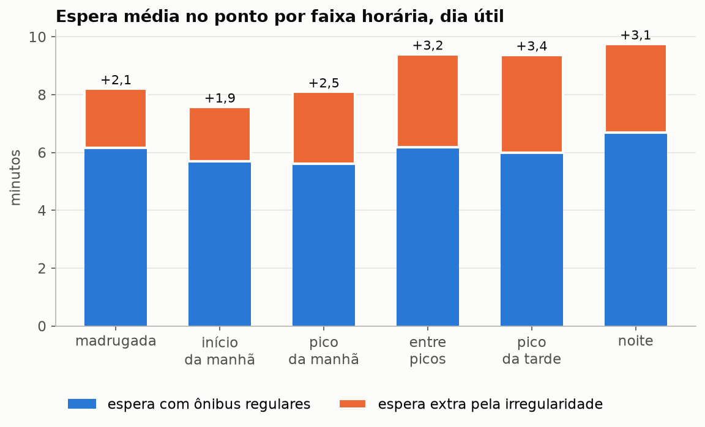
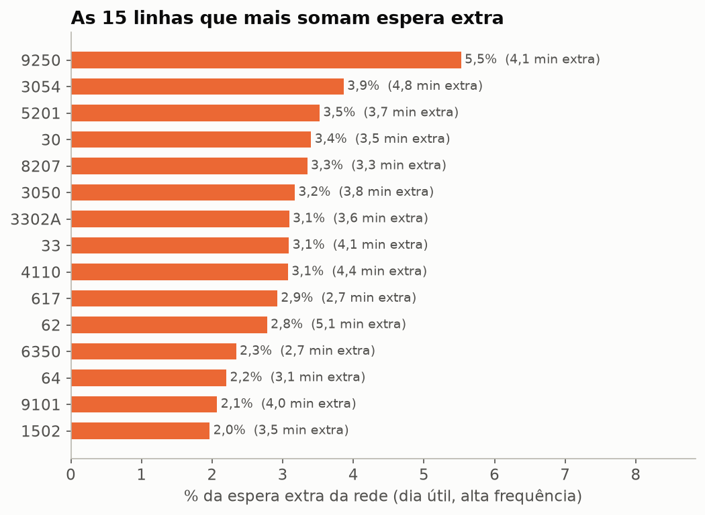
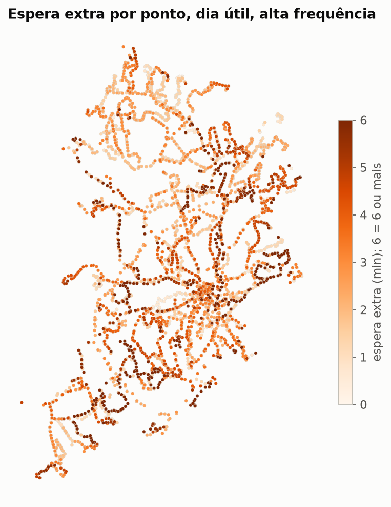
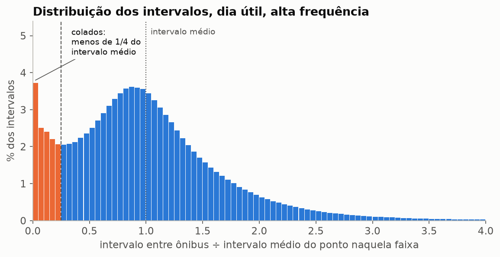

# Quanto o passageiro espera a mais por ônibus irregular (fase 4)

**Em dia útil, quem chega ao ponto de uma linha de alta frequência espera em
média 8,9 minutos pelo ônibus dela. Com os mesmos ônibus passando em intervalos
iguais, seriam 5,9 minutos. A diferença, 2,9 minutos (+50%), é o custo da
irregularidade.** Pelo menos um quarto dela vem de ônibus colados um no outro
(*bus bunching*). 20 das 192 linhas somam 55% da espera extra, mais por rodarem
muito (47% das horas de serviço) do que por serem muito piores que as outras.

Janela: 15/09 a 05/11/2026, 52 dias, dados do feed GTFS-Realtime da Prefeitura
de Belo Horizonte coletados por este projeto. Todos os números saem dos CSVs em
[`analise/saida/`](../analise/saida/), gerados por
[`analise/calcular.py`](../analise/calcular.py) a partir da Gold. O último
quadro diz onde conferir cada um.

## Recomendação

1. **Começar pelas 20 linhas da tabela da seção 3.2.** Elas respondem por 55,3%
   da espera extra da rede em dia útil (as 10 primeiras, por 35,0%; as 40
   primeiras, por 79,7%). A taxa delas é 3,49 minutos por passageiro, contra
   2,95 na rede: o peso vem sobretudo do tamanho do serviço, então é onde o
   mesmo esforço de controle alcança mais gente.
2. **Regularizar o espaçamento dos ônibus colados nessas 20 linhas cortaria
   13,5% da espera extra da rede** (cerca de 0,4 minuto por passageiro; 24,3%
   dentro delas). A conta supõe que o ônibus atrasado, que abriu um buraco e
   puxou o de trás para colado, passe no meio do caminho entre os dois: é o
   tamanho do problema dos colados, não o ganho garantido de uma técnica
   (seção 7).
3. **Nas 192 linhas, o mesmo corte chega a 24,5%** (0,72 minuto). O restante
   não sai dessa conta: inclui comboios de três ou mais ônibus, que ela deixa
   de fora, e a variação de intervalo sem colagem. Isso pede controle de
   espaçamento desde o despacho no terminal, não só no caminho.
4. **Mirar a tarde pela taxa, sem esquecer a manhã pelo volume.** O pico da
   tarde (16 h às 19 h) e o entre picos (9 h às 15 h) têm as maiores esperas
   extras por passageiro (3,4 e 3,2 minutos, contra 2,5 no pico da manhã). Por
   hora de relógio, porém, o pico da manhã soma mais espera extra, porque tem
   mais serviço.
5. **Agir por linha.** O controle de espaçamento é feito linha a linha, e a
   espera extra por ponto se distribui como a por linha: concentrada onde há
   mais serviço. O corredor da Av. Waldyr Soeiro Emrich foge disso e merece
   olhar próprio (seção 3.3).

## 1. A medida

Um passageiro que chega ao ponto sem olhar o horário cai, com mais
probabilidade, num intervalo longo, porque intervalos longos ocupam mais tempo
do relógio. Se os intervalos entre ônibus de uma linha num ponto são H, a
espera média é

    E[H²] / (2 E[H])  =  E[H]/2  +  Var(H) / (2 E[H])

O primeiro termo é a espera com ônibus regulares (metade do intervalo). O
segundo é a **espera extra pela irregularidade**: zero quando todos os
intervalos são iguais, e cresce com a variação deles.

Isso só vale onde o passageiro não consulta horário, ou seja, em serviço
frequente. Por isso o recorte principal é **alta frequência: intervalo médio de
até 15 minutos** na linha, sentido, dia e faixa horária. Fora dele (trechos de
302 das 311 linhas em dia útil, intervalos de meia hora em média) a conta dá 4,0 minutos de
espera extra sobre 14,3 regulares, mas não representa ninguém: quem pega ônibus
de meia em meia hora sai de casa no horário.

## 2. O que a rede mostra (dia útil, alta frequência)

| | Valor |
|---|---|
| Linhas | 192 |
| Intervalos medidos | 9.886.060 |
| Horas de serviço cobertas | 1.748.928 |
| Espera com ônibus regulares | 5,944 min |
| Espera extra pela irregularidade | 2,948 min (+49,6%) |
| Intervalos colados (menos de 1/4 do intervalo médio) | 12,91% |
| Intervalos abaixo de 60 s | 6,79% |
| Parte da espera extra que some sem colagem | 24,47% |

A média é ponderada pelo tempo coberto: cada linha num ponto pesa pelas horas
de serviço que cobre, então 4 horas de serviço pesam quatro vezes 1 hora. É a
espera de um passageiro que chega a um ponto e instante quaisquer. Com peso igual para cada
linha-sentido-dia-faixa, a espera extra seria 2,327 min (+41%). A diferença diz que os
trechos com mais tempo de serviço são os mais irregulares.

## 3. Onde se concentra

### 3.1 Por faixa horária

| Faixa | Horas | Regular (min) | Extra (min) | % da espera extra da rede | Colados |
|---|---|---|---|---|---|
| madrugada | 0 h às 4 h | 6,154 | 2,055 | 0,2% | 7,2% |
| início da manhã | 5 h | 5,698 | 1,881 | 4,2% | 9,3% |
| pico da manhã | 6 h às 8 h | 5,602 | 2,498 | 25,6% | 13,5% |
| entre picos | 9 h às 15 h | 6,174 | 3,229 | 37,8% | 12,5% |
| pico da tarde | 16 h às 19 h | 5,999 | 3,380 | 28,5% | 13,7% |
| noite | 20 h às 23 h | 6,696 | 3,063 | 3,7% | 13,1% |

A irregularidade cresce ao longo do dia. O pico da manhã tem tantos colados
quanto o da tarde, mas 0,9 minuto a menos de espera extra: à tarde pesa mais o
buraco longo entre ônibus que o par colado. Entre picos lidera o volume por
ter 7 horas; por hora, quem pesa mais é o pico da manhã, que tem mais serviço.

### 3.2 Por linha

A ordem é pelo volume: espera extra vezes horas de serviço cobertas. Uma linha
sobe na lista por ser muito irregular, por rodar muito, ou pelos dois.

| Linha | Nome | Regular (min) | Extra (min) | % da rede | Colados | Corte sem colagem |
|---|---|---|---|---|---|---|
| 9250 | Caetano Furquim/Nova Cintra Via Savassi | 6,28 | 4,11 | 5,5% | 13,2% | 24,9% |
| 3054 | Milionarios/Centro | 6,32 | 4,84 | 3,9% | 16,1% | 27,5% |
| 5201 | Dona Clara/Buritis | 5,97 | 3,75 | 3,5% | 16,0% | 21,5% |
| 30 | Estação Diamante/Centro | 4,47 | 3,51 | 3,4% | 20,0% | 25,5% |
| 8207 | Maria Goretti/Estrela Dalva | 5,70 | 3,31 | 3,3% | 16,2% | 27,9% |
| 3050 | Estação Diamante/Hospitais Via Bh Shopping | 4,60 | 3,78 | 3,2% | 20,6% | 22,2% |
| 3302A | Nova Pampulha/Centro - Via Zoológico | 6,15 | 3,61 | 3,1% | 14,7% | 24,8% |
| 33 | Estação Barreiro/Centro-Hospitais | 5,59 | 4,10 | 3,1% | 14,6% | 24,7% |
| 4110 | Dom Cabral/Belvedere | 5,54 | 4,41 | 3,1% | 14,3% | 18,4% |
| 617 | Estação Pampulha / Piratininga Via Rio Branco | 4,80 | 2,74 | 2,9% | 15,2% | 24,7% |

As 20 primeiras estão em `linhas.csv` (filtro `tipo_dia = dia_util`,
`alta_frequencia = True`, ordem decrescente de `volume_min_h`).

Pela taxa, entre linhas com pelo menos 2.000 horas de serviço, as piores são a
82 (Estação São Gabriel / Savassi Via Hospitais), com 6,03 minutos de espera
extra sobre 5,71 regulares, ou seja, mais que dobra a espera; depois 3029
(5,27), 62 (5,09), 806 (5,02) e 311 (4,84). As mais regulares ficam perto de
1 minuto: 715, 641, S33, 707 e 9211.

### 3.3 Por ponto e corredor

São 5.378 pontos servidos por linha de alta frequência; o mapa mostra os 3.912
com pelo menos 50 horas de serviço. Os 50 piores pontos somam 8,4% da espera
extra e os 500 piores, 41,8%, com 33,0% das horas de serviço. Como nas linhas,
a concentração acompanha sobretudo o serviço.

Um corredor se destaca:

| Corredor (nome do ponto contém) | Pontos | Regular (min) | Extra (min) | Colados |
|---|---|---|---|---|
| Avenida Waldyr Soeiro Emrich | 32 | 6,60 | 4,78 | 16,9% |
| Cristiano Machado | 95 | 6,28 | 3,37 | 12,0% |
| Avenida Amazonas | 84 | 5,25 | 3,12 | 15,3% |
| Afonso Pena | 37 | 5,53 | 3,03 | 17,1% |

Na Waldyr Soeiro Emrich, vários pontos têm cerca de 8,9 minutos de espera extra
sobre 8,2 regulares, com 30% dos intervalos colados. Os valores do corredor são
médias dos pontos ponderadas pelas horas de serviço, com o filtro de nome em
`paradas.csv`.

## 4. Ônibus colados

Colado é o intervalo menor que 1/4 do intervalo médio daquela linha, naquele
ponto, dia e faixa. São 12,91% dos intervalos; 6,79% ficam abaixo de 60
segundos, dois ônibus da mesma linha praticamente juntos.

Quanto eles custam: para cada colado, o intervalo anterior é o buraco que o
ônibus atrasado deixou à frente dele. Fazer o atrasado passar no meio do
caminho iguala os dois intervalos, mantém o mesmo número de ônibus e o
mesmo intervalo médio e tira 24,47% da espera extra. É um piso para o
peso dos colados: os comboios ficam de fora. Dos colados, 1.106.991
entraram nessa conta; 11.155 ficaram de fora por serem o primeiro intervalo do
grupo e 158.003 por terem o anterior também colado (comboio de três ou mais).
As três parcelas somam todos os colados.

## 5. Fim de semana

| Tipo de dia | Grupos | Regular (min) | Extra (min) | Colados |
|---|---|---|---|---|
| dia útil | 540.332 | 5,944 | 2,948 | 12,9% |
| sábado | 12.828 | 6,062 | 2,280 | 11,7% |
| domingo e feriado | 6.730 | 6,002 | 3,100 | 13,1% |

Grupo aqui é linha, sentido, ponto, dia e faixa. Pouca coisa roda com intervalo
de até 15 minutos no fim de semana (43 mil horas cobertas nos sábados e 21 mil
nos domingos e feriados, contra 1,75 milhão nos dias úteis), então esses números pesam pouco. O
domingo tem a maior espera extra por passageiro das três.

## 6. Método

- **Fonte:** Gold do projeto (`int_headways`, `int_passagens` para o viés,
  `fct_servico_linha_faixa`, `ref/faixa_horaria`), só intervalos válidos
  (`headway_valido`: tira os que atravessam feed parado e os acima de 180
  minutos). Linhas e pontos com nome e coordenada do GTFS
  estático da PBH: o `route_id` do tempo real é o `route_short_name` do GTFS
  (311 de 311 linhas batem) e o `stop_id` é o mesmo (9.211 de 9.211).
- **Grupo:** linha, sentido, ponto, dia e faixa horária, com pelo menos 3
  intervalos e média maior que zero. Por grupo, com n intervalos de média m:
  espera regular m/2, espera extra Σ(H − m)² / (2 n m), peso n m (tempo coberto).
- **Alta frequência:** vem de `fct_servico_linha_faixa`, que classifica a
  linha no sentido, dia e faixa (intervalo médio de até 15 minutos).
- **Volume:** espera extra vezes horas cobertas (`volume_min_h`). É o que
  ordena linhas e pontos e o que soma 100% da rede.
- **Corte sem colagem:** para cada colado com o anterior não colado, troca os
  dois pela média deles (o ônibus entre eles passa no meio do caminho); a queda em Σ(H − m)² é (H anterior − H colado)² / 2.
- **Viés da interpolação:** a passagem no ponto é interpolada entre duas
  posições do veículo, e esse erro infla a variância. Estimado em 0,005 minuto
  (0,16% da espera extra), desprezível.
- **Segunda conta:** a espera extra por grupo e por linha foi refeita no script
  e comparada com os marts da Gold, e a contagem de intervalos com
  `fct_qualidade_diaria` (seção 8).

## 7. Ressalvas

- **Sem dado de demanda.** O peso por tempo coberto supõe passageiros chegando
  na mesma taxa em todo ponto e hora. Um ponto vazio pesa o mesmo que um lotado
  com o mesmo serviço. Com dados de bilhetagem, a ordem das linhas pode mudar.
- **Espera por linha.** A conta é de quem espera uma linha específica. Quem
  aceita qualquer linha do ponto espera menos.
- **Alta frequência é da linha, não do ponto.** Alguns pontos dessas linhas
  veem intervalo médio maior que 15 minutos (a Waldyr Soeiro Emrich 18 tem 12,6
  minutos de espera regular). Ali a espera estimada vale menos.
- **O corte sem colagem mede o problema, não uma técnica.** Igualar o buraco
  e o colado exige que o ônibus atrasado ganhe tempo, ou que o da frente seja
  segurado antes; segurar o colado no ponto mexe no colado e no intervalo
  seguinte, não no buraco, e custa tempo a quem está dentro dele. O ganho real
  de cada técnica pede simulação própria. A conta também deixa de fora os
  comboios de três ou mais.
- **Madrugada e noite** têm pouco serviço de alta frequência; os números delas
  pesam pouco no total.

## 8. Como reproduzir

Na VM de processamento, com a Gold atualizada, começando entre os minutos :00
e :40 para não cruzar com o Spark da DAG horária (um Spark por vez):

    docker run --rm -v /home/ubuntu/radar:/app -v /home/ubuntu/ivy:/root/.ivy2.5.2 \
        radar-spark:dev python /app/analise/calcular.py

Leva cerca de 10 minutos e grava os CSVs em `~/radar/dados/analise/`. Copiados
para `analise/saida/`, os gráficos saem com:

    py -3.11 analise/graficos.py analise/saida

## Número, onde conferir

Todos os arquivos estão em `analise/saida/`. Salvo indicação, a linha é
`tipo_dia = dia_util`, `alta_frequencia = True`; as colunas `colados_pct`,
`abaixo_60s_pct`, `reducao_pct` e `vies_pct` são frações (0,1291 = 12,91%).

| Número | Onde conferir |
|---|---|
| 5,944 min regular, 2,948 min extra, 192 linhas, 9.886.060 intervalos, 1.748.928 h | `rede.csv`: `regular_min`, `excesso_min`, `headways`, `horas`; linhas em `linhas.csv` (contar) |
| 12,91% colados, 6,79% abaixo de 60 s, 24,47% de corte | `rede.csv`: `colados_pct`, `abaixo_60s_pct`, `reducao_pct` |
| 1.106.991 pares, 11.155 e 158.003 fora | `rede.csv`: `pares`, `pulo_primeiro`, `pulo_colado` |
| Viés de 0,005 min (0,16%) | `rede.csv`: `vies_min`, `vies_pct` |
| 2,327 min com peso igual | `rede_peso_igual.csv`: `excesso_min_peso_igual` |
| Faixas horárias | `rede_faixa.csv`; parcela = `volume_min_h` da faixa sobre a soma |
| 20 linhas = 55,3%; 10 = 35,0%; 40 = 79,7% | `linhas.csv`: soma de `volume_min_h` das N maiores sobre o total |
| 20 linhas = 46,7% das horas; taxa 3,49 contra 2,95 | `linhas.csv`: soma de `horas`; soma de `volume_min_h` ÷ soma de `horas` |
| Corte de 13,5% da rede (24,3% nas 20) | `linhas.csv`: soma de `volume_min_h × reducao_pct` das 20 maiores sobre o total (e sobre a soma delas) |
| Taxas por linha (82, 3029, 62, 806, 311) | `linhas.csv` com `horas` ≥ 2000, ordem de `excesso_min` |
| Linha por faixa | `linhas_faixa_dia_util.csv` |
| 5.378 pontos; 50 = 8,4%; 500 = 41,8% (33,0% das horas) | `paradas.csv`: mesma conta das linhas, e soma de `horas` dos 500 sobre o total |
| Corredores | `paradas.csv`: `stop_name` contém o nome; média de `excesso_min` e `regular_min` ponderada por `horas`, de `colados_pct` por `headways` |
| Sábado, domingo e feriado | `rede.csv`, `tipo_dia = sabado` e `domingo_feriado` |
| Baixa frequência (4,0 sobre 14,3) | `rede.csv`, `alta_frequencia = False` |
| Histograma dos intervalos | `hist_h_sobre_media.csv` (classe × 0,05 = intervalo ÷ média) |
| Grupos iguais ao mart `fct_headway_parada_faixa` | `conferencia_grupos.csv`: 0 sem par, diferença máxima 4e-14 min |
| Linhas iguais ao mart `fct_servico_linha_faixa` | `conferencia_linhas.csv`: 0 sem par, diferença máxima 2e-14 min |
| 52 dias, 49.230.353 intervalos válidos iguais a `fct_qualidade_diaria` | `conferencia_qualidade.csv`: 0 de diferença |
