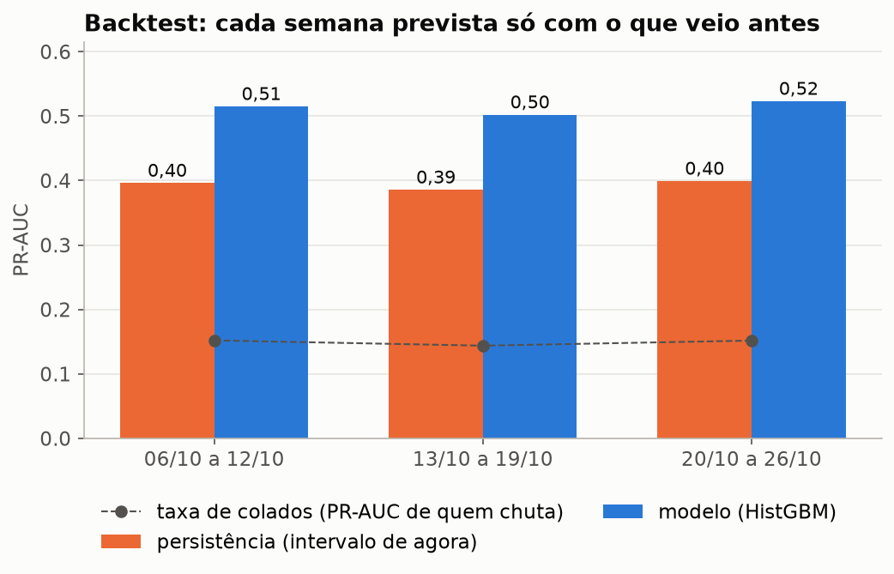
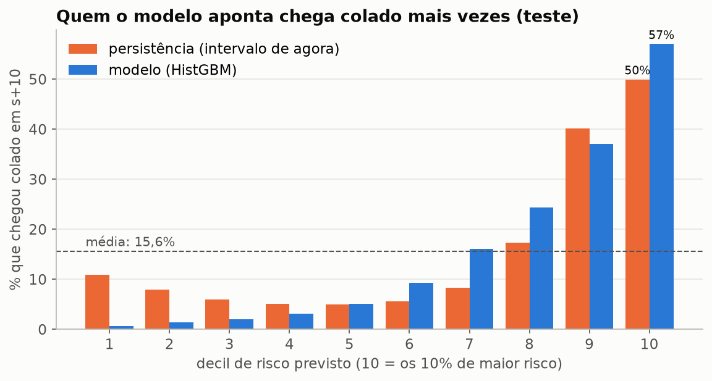
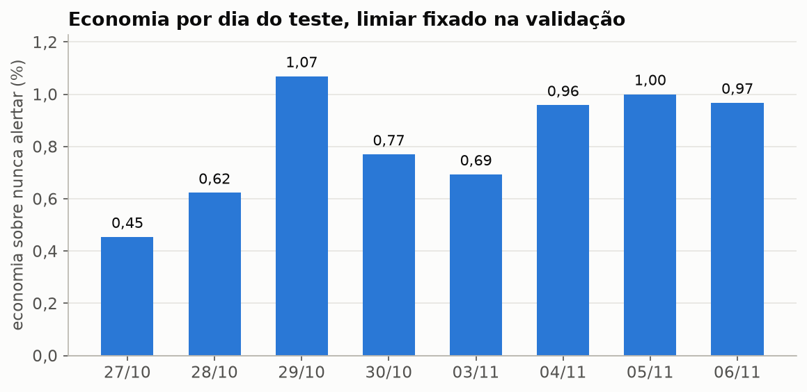
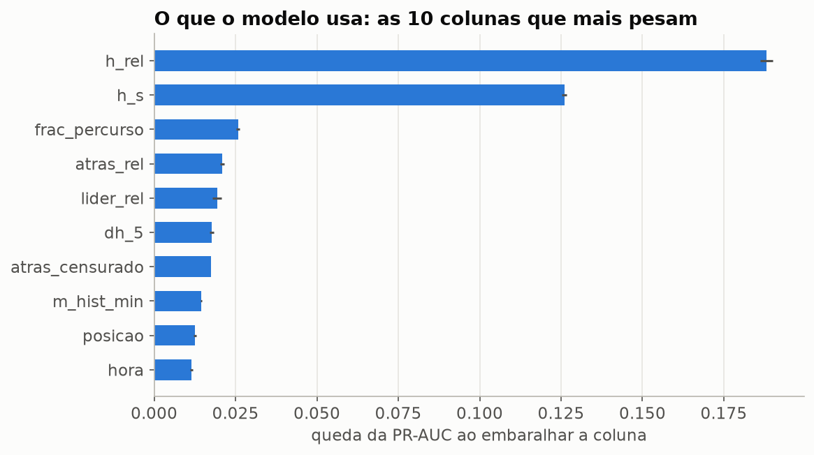

# Prever ônibus colados dez paradas antes (fase 5)

Dá para saber com dez paradas de antecedência quais ônibus vão chegar colados:
no teste (27/10 a 06/11, 1,4 milhão de passagens), o modelo teve PR-AUC 0,511
contra 0,392 de olhar só o intervalo de agora, e entre os 10% que ele aponta
como mais arriscados 57% chegaram colados. Com a hipótese de custo da seção 4,
porém, alertar poupa só 0,8% do custo de nunca alertar, porque o acerto de 67%
fica pouco acima dos 60% que um alerta precisa para se pagar.

Janela: 29/09 a 06/11/2026, dias úteis, linhas de alta frequência. Exemplos
montados da Gold por [`ml/montar.py`](../ml/montar.py), modelos e métricas por
[`ml/treinar.py`](../ml/treinar.py), previsões publicadas na Gold por
[`ml/publicar.py`](../ml/publicar.py) em `gold/ml/previsao_bunching`. Os CSVs
saem em `~/radar/dados/ml/saida` na VM de processamento e estão copiados em
[`ml/saida/`](../ml/saida).

## Recomendação

1. **O modelo é bom o bastante para ordenar quem olhar primeiro.** Bate os três
   baselines nos dois recortes da validação e do teste, bate a persistência nas
   três semanas do backtest, e a probabilidade é confiável (no decil de maior risco, 56,8% previstos e 57,0% reais).
2. **Não vale ligar alertas automáticos com a hipótese de custo atual.** O ganho
   é de 0,45% a 1,07% por dia. Antes, é preciso medir na operação quanto custa
   uma intervenção e quantos pares ela de fato evita: com 50% de eficácia, cada
   alerta deixa saldo de só 3,7 unidades sobre os 30 que custa.
3. **Uso sugerido: lista de prioridade.** Mostrar ao controle os ônibus no
   decil 10 de risco, sem disparar ação. Isso não depende dos pesos de custo e
   já entrega a parte que o modelo faz bem.

## 1. A pergunta

Um ônibus B acabou de passar pela parada s. Ele vai chegar colado no ônibus da
frente dez paradas adiante, em s+10? Se der para saber com antecedência, quem
controla a operação pode segurar o ônibus de trás ou adiantar o da frente antes
de o par se formar.

**Colado** é a definição da fase 4 ([`docs/analise.md`](analise.md), seção 4):
intervalo menor que 0,25 vez a média do grupo (linha, sentido, parada, dia,
faixa horária), em grupo com pelo menos 3 intervalos válidos.

**Um exemplo** é uma passagem de B por s em dia útil, numa linha e sentido de
alta frequência na faixa, com intervalo válido em s e alvo definido em s+10.
"Alta frequência" usa a média dos 14 dias anteriores (até 15 min), não o
próprio dia, que ainda não aconteceu na hora da decisão.

## 2. O que o modelo pode ver

A decisão acontece no instante em que a passagem por s fica conhecida: a hora
da passagem mais o intervalo entre as duas posições do GPS que a geraram. Tudo
que o modelo vê sobre os vizinhos já existia nesse instante (ver a ressalva 7
sobre o ônibus da frente). A lista fechada está em
[`ml/features.py`](../ml/features.py), com o motivo de cada coluna proibida.

| Grupo | Colunas |
|---|---|
| Intervalo agora | `h_s`, `h_rel` (sobre a média histórica da parada na faixa), `dh_1`, `dh_3`, `dh_5` (variação desde s-1, s-3, s-5) |
| Vizinhos | `lider_rel` (o da frente para o líder dele), `atras_rel` e `atras_censurado` (o de trás, em s-5) |
| Ritmo | `trecho_razao`: tempo de B de s-5 até s sobre a média histórica do trecho |
| Histórico (14 dias corridos antes, só dias úteis) | `m_hist_min`, `taxa_colado_hist` |
| Contexto | `hora`, `dia_semana`, `posicao`, `frac_percurso`, `paradas_no_intervalo`, `intervalo_s` |

Dois cuidados que mudam o resultado:

1. **Ônibus de trás ainda não conhecido.** Se o ônibus de trás não passou por
   s-5 até o instante da decisão, o intervalo real dele ainda não existe. Entra
   o tempo decorrido desde que B passou por s-5, com `atras_censurado = 1`. Usar
   o intervalo real seria olhar o futuro.
2. **Líder conhecido depois da decisão fica fora.** O mesmo vale para o líder
   do ônibus da frente.

Os dois casos têm teste em [`tests/test_ml.py`](../tests/test_ml.py).

Ficam de fora, entre outras: a média do próprio dia (usa intervalos que ainda
vão acontecer), identificadores de linha, parada, viagem e ônibus (o modelo
decoraria) e a data.

## 3. Divisão e avaliação

| Conjunto | Dias | Uso |
|---|---|---|
| Treino | 29/09 a 19/10 | ajustar os modelos |
| Validação | 20/10 a 26/10 | escolher a configuração e o limiar |
| Teste | 27/10 a 06/11 | medir uma vez, no fim |

Os exemplos começam em 29/09 porque o histórico olha os 14 dias anteriores e a
Gold começa em 15/09. O teste roda uma vez só: o script se recusa a rodar de
novo se o resultado já existe.

**Backtest.** Três blocos de 7 dias dentro de treino e validação. Cada bloco é
previsto por um modelo treinado só com o que veio antes dele.

**Baselines.** O modelo só vale se bater:

1. **Persistência**: quanto menor o intervalo agora, maior o risco. É o que um
   controlador olhando o mapa faria.
2. **Taxa histórica**: a taxa de colados do treino por classe de `h_rel` e
   faixa horária.
3. **Regressão logística** sobre as mesmas colunas.

O modelo principal é um `HistGradientBoostingClassifier` (scikit-learn), com
três configurações e a escolhida pela PR-AUC na validação.

**Métricas.** PR-AUC (área sob a curva de precisão e cobertura), porque os
colados são minoria e a PR-AUC de quem chuta é a própria taxa de colados.
ROC-AUC e Brier como apoio. Validação e teste em dois recortes: todos os exemplos e só os que
ainda não estão colados em s, que é onde a previsão tem algo a acrescentar.

**Prova de vazamento.** Um modelo treinado com o alvo disfarçado entre as
colunas precisa dar resultado quase perfeito. Se não der, o pipeline está
perdendo informação no caminho e as outras métricas não valem.

## 4. O limiar pelo custo

Alerta não é de graça. A hipótese, em unidades arbitrárias:

| Item | Valor |
|---|---|
| Custo de um alerta (intervenção do controle) | 30 |
| Custo de um par colado que acontece | 100 |
| Parte dos colados que o alerta evita | 50% |

Com esses valores, um alerta só se paga quando acerta em mais de 60% das vezes
(30 / (0,5 × 100)). O limiar é o de menor custo total na validação e fica fixo
no teste. Os valores estão em [`ml/custo.py`](../ml/custo.py); trocar a hipótese
muda o limiar, não o modelo.

## 5. Resultados

Os números saem dos CSVs em `ml/saida/`. Validação e backtest serviram para
escolher; o teste rodou uma vez, com configuração e limiar já fixados.

### 5.1 Validação e teste

PR-AUC (quem chuta tira a própria taxa de colados, na coluna "base"):

| Modelo | Validação, todos | Validação, não colados em s | Teste, todos | Teste, não colados em s |
|---|---|---|---|---|
| base (quem chuta) | 0,152 | 0,104 | 0,156 | 0,108 |
| persistência | 0,399 | 0,269 | 0,392 | 0,262 |
| taxa histórica | 0,405 | 0,243 | 0,398 | 0,237 |
| regressão logística | 0,412 | 0,254 | 0,405 | 0,246 |
| **HistGBM** | **0,523** | **0,376** | **0,511** | **0,361** |

ROC-AUC do HistGBM: 0,862 na validação e 0,851 no teste (persistência: 0,753 e
0,747). Brier: 0,094 e 0,099. A queda da validação para o teste é pequena
(0,012 de PR-AUC) e o ganho sobre a persistência se mantém (0,119 no teste).

As três configurações empataram na validação (0,520, 0,523 e 0,523); ficou a do
meio (taxa de aprendizado 0,1, até 63 folhas, mínimo de 500 exemplos por
folha). **Prova de vazamento:** com o alvo disfarçado entre as colunas, a
PR-AUC vai a 0,980. O pipeline entrega a informação ao modelo; as métricas
acima valem.

### 5.2 Backtest



| Semana prevista | Treino antes dela | HistGBM | Persistência | Base |
|---|---|---|---|---|
| 06/10 a 12/10 | 971.882 | 0,515 | 0,396 | 0,152 |
| 13/10 a 19/10 | 1.724.044 | 0,502 | 0,386 | 0,144 |
| 20/10 a 26/10 | 2.739.335 | 0,523 | 0,399 | 0,152 |

O ganho fica entre 0,116 e 0,124 nas três semanas. Com uma semana só de treino
o modelo já chega perto do resultado final. A semana de 20/10 a 26/10 é a
própria validação, onde a configuração foi escolhida: o 0,523 dela sai
levemente otimista. O teste não depende dessa escolha.

### 5.3 Decis



No teste, o HistGBM separa bem as duas pontas: 0,7% de colados no decil de
menor risco e 57,0% no de maior risco, com a média prevista de cada decil a
menos de 0,6 ponto da taxa real. A persistência tem forma de U: o decil de
**maior** intervalo agora chega colado 10,9% das vezes, mais que os decis do
meio (cerca de 5%). Os CSVs não dizem por quê: não há recorte por faixa de
`h_rel`. Uma hipótese é o ônibus muito atrás do da frente que recupera tempo
no trecho seguinte. O HistGBM não tem esse U: a taxa real sobe decil a
decil.

### 5.4 Custo

| | Validação (5 dias) | Teste (8 dias) |
|---|---|---|
| Limiar | 0,590 | 0,590 (fixado na validação) |
| Alertas | 34.784 | 49.154 |
| Acerto (precisão) | 68,2% | 67,4% |
| Colados avisados (cobertura) | 15,9% | 15,1% |
| Custo com o modelo | 14,76 milhões | 21,79 milhões |
| Custo de nunca alertar | 14,91 milhões | 21,97 milhões |
| Custo de sempre alertar | 36,93 milhões | 53,21 milhões |
| Economia sobre nunca alertar | 0,95% | 0,83% |



Todos os oito dias do teste economizam, de 0,45% (27/10) a 1,07% (29/10). O
acerto fica acima de 60% em todos (de 64,7% a 69,3%). O ganho é pequeno porque
a margem por alerta é pequena: com 50% de eficácia, um acerto evita 50
unidades de custo e o alerta custa 30.

### 5.5 O que o modelo usa



O intervalo de agora (`h_rel` e `h_s`) responde pela maior parte. Depois vêm
quanto do percurso já foi feito (`frac_percurso`), os vizinhos (`atras_rel`,
`lider_rel`, `atras_censurado`) e a variação recente do intervalo (`dh_5`).
`dia_semana` e `intervalo_s` quase não pesam (0,0003 e 0).

### 5.6 Estabilidade (PSI)

O PSI compara a distribuição de cada coluna no teste com a do treino; acima de
0,25 costuma indicar mudança. Todas as colunas ficaram abaixo de 0,04, menos
`dia_semana` (1,69). Isso vem do calendário: 02/11 foi Finados e saiu da
montagem, então o teste não tem nenhuma segunda-feira, e a classe vazia leva o
PSI para cima. A coluna quase não pesa no modelo (seção 5.5).

## 6. Ressalvas

1. **Meia-noite.** Os exemplos são montados um dia por vez. O primeiro ônibus
   do dia fica sem líder e o último fica sem ônibus de trás; viagens que cruzam
   a meia-noite são cortadas. Afeta sobretudo a madrugada.
2. **Seis semanas de dados.** Sem feriado prolongado, férias escolares ou
   mudança de quadro de horários no teste. O PSI mostra se o teste já se
   afastou do treino.
3. **Custo hipotético.** Os pesos do custo não vieram da operação. A seção 4
   diz como trocar.
4. **Avaliação offline.** O modelo não roda na DAG; as previsões publicadas são
   de dias que já passaram.
5. **Feriados fora.** 12/10 e 02/11 não entram (só dias úteis). O treino tem
   14 dias, a validação 5 e o teste 8.
6. **Teto de iterações.** As três configurações usaram as 400 árvores
   permitidas sem parar antes. Mais árvores talvez ajudem um pouco, mas a
   diferença entre configurações bem distintas foi de 0,003.
7. **Ônibus da frente em s.** O intervalo `h_s` (e `h_rel`, `dh_*`) usa a
   passagem do ônibus da frente por s (e por s-1, s-3 e s-5). A montagem
   confere se essa passagem já era conhecida na decisão, mas só usa a
   conferência para esconder `lider_rel`, não `h_s`. A fração foi medida
   depois, com [`ml/medir_frente.py`](../ml/medir_frente.py)
   (`ml/saida/frente.csv`): a passagem da frente chegou depois da decisão em
   0,014% a 1,07% dos 5.129.305 exemplos (no teste, 0,018% a 1,10%). São dois
   limites porque a Gold não guarda o instante exato da posição seguinte do
   GPS: o mais cedo possível e a regra conservadora da montagem. Só a passagem
   em s, que entra em `h_s`, chega tarde pela regra em 48.557 exemplos (0,95%):
   85% deles até 30 s depois da decisão e nenhum passa de 5 min. O atraso das
   passagens em s-1, s-3 e s-5, que entram em `dh_*`, não foi medido.
   A persistência usa o mesmo `h_rel`, então o efeito vale para o modelo e para
   o baseline, nas três fases. Em produção, basta usar `h_s` só depois que a
   passagem da frente existir.
8. **Latência do feed.** O instante da decisão não soma o atraso entre o evento
   e a primeira coleta (mediana de 41 s, ver o README). Na operação, a
   previsão sairia cerca de um minuto depois.
9. **Mapa de paradas.** A última parada de cada linha (`posicao`,
   `frac_percurso`) vem do mapa aprendido sobre todo o histórico, inclusive o
   período de teste. É estrutura que muda pouco, mas não é estritamente
   anterior.
10. **Alvo que já passou.** Quando um único intervalo de GPS cobre s e s+10, B
    já passou por s+10 no instante da decisão (`minutos_ate_alvo` ≤ 0). As
    features não veem o alvo, mas esses exemplos não são previsão: 1,10% dos
    5.129.305 (0,75% no treino, 1,36% na validação, 1,60% no teste). Medido
    com [`ml/medir_alvo_passado.py`](../ml/medir_alvo_passado.py)
    (`ml/saida/alvo_passado.csv`) sobre as previsões já gravadas, sem treinar
    nem escolher nada de novo. Sem eles, a PR-AUC do teste fica em 0,513
    (persistência 0,395), contra 0,511 e 0,392 com eles: não inflam o
    resultado. Nesses casos o modelo acerta menos (PR-AUC 0,399). Em produção,
    basta não emitir previsão quando o intervalo já cobre s+10.
11. **Só entra quem chega a s+10.** O exemplo só existe se a passagem de B em
    s+10 tem intervalo válido e rotulável. Na hora da decisão isso ainda não se
    sabe. Viagem que some do feed ou termina antes de s+10 fica fora, e as
    métricas valem só para quem chega lá.

## 7. Como reproduzir

Na VM de processamento, fora da janela da DAG (minutos 50 a 58 de cada hora),
um contêiner por vez. O treino cabe em 4 GB porque lê os exemplos em lotes com
tipos pequenos e devolve a memória ao sistema entre etapas (pico de 1,65 GB na
rodada de 08/11):

```bash
docker run --rm --memory 4g -e ML_MEMORIA=3g -v /home/ubuntu/radar:/app -v /home/ubuntu/ivy:/root/.ivy2.5.2 -w /app radar-ml:dev python -m ml.montar
docker run --rm --memory 4g -v /home/ubuntu/radar:/app -w /app radar-ml:dev python -m ml.treinar
docker run --rm --memory 4g -v /home/ubuntu/radar:/app -w /app radar-ml:dev python -m ml.treinar --teste
docker run --rm -v /home/ubuntu/radar:/app -v /home/ubuntu/ivy:/root/.ivy2.5.2 radar-ml:dev python -m ml.publicar
docker run --rm --memory 4g -e ML_MEMORIA=3g -v /home/ubuntu/radar:/app -v /home/ubuntu/ivy:/root/.ivy2.5.2 -w /app radar-ml:dev python -m ml.medir_frente
docker run --rm --memory 4g -v /home/ubuntu/radar:/app -w /app radar-ml:dev python -m ml.medir_alvo_passado
```

Gráficos, no Windows, com os CSVs copiados para `ml/saida/`:

```bash
py -3.11 ml/graficos.py ml/saida
```
